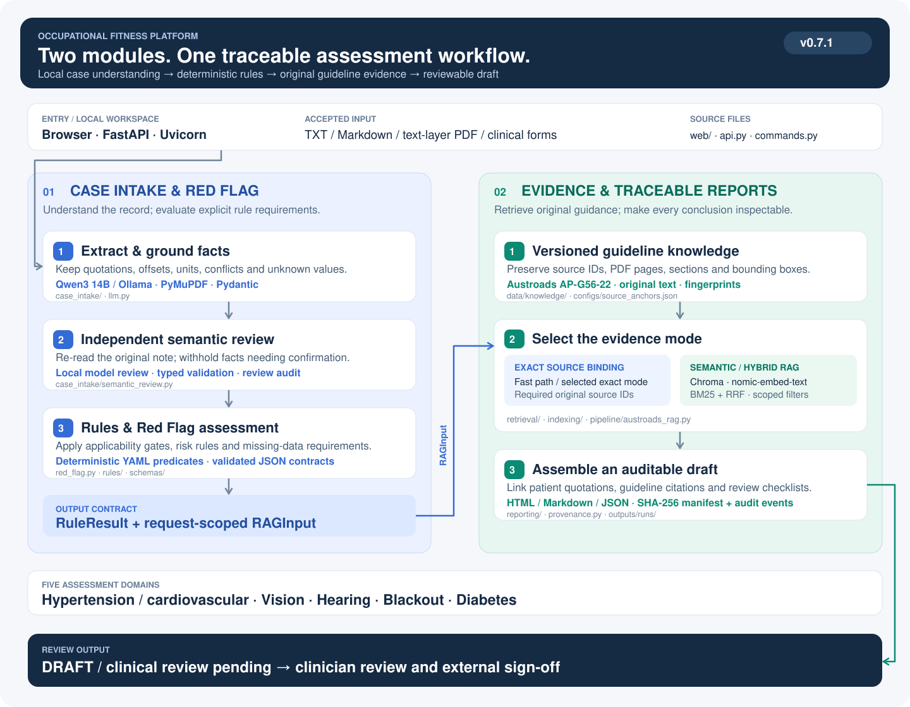

# Occupational Fitness Platform

A traceable local assessment workspace for occupational-health teams and commercial-driver reviews. It combines **grounded case intake and deterministic Red Flag rules** with **guideline evidence retrieval and auditable draft reports** across five assessment domains.

**Software 0.7.1** · **Austroads AP-G56-22** · **Local Ollama / Qwen3 14B** · **DRAFT / clinical review pending**

[Quick start](#getting-started) · [Modules & technology](#modules-and-technology) · [Measured progress](#measured-progress) · [Runbook](docs/runbook.md) · [Assessment records](outputs/index.html)

## Engineering architecture



[Open the full-size architecture](docs/assets/platform-architecture.svg). The diagram follows the current GitHub workflow: fast cases bind exact sources; other cases select exact binding or semantic RAG after deterministic routing. Research routes run in separate experiment configurations.

## Modules and technology

Implementation status checked against GitHub `main` on **2026-11-04**. Paths below are relative to `src/occupational_fitness_rag/` unless rooted at another repository directory.

| Module / capability | What it does | Technology stack | Current progress / implementation |
|---|---|---|---|
| **01 · Case intake & Red Flag** | Turns clinical notes into source-linked facts, checks meaning, evaluates applicability and missing information, and emits rule outcomes and retrieval requests | Python ≥3.11; PyMuPDF; Ollama / Qwen3 14B; Pydantic 2; YAML rules | Implemented local workflow; `case_intake/`, `red_flag.py`, `rules/`, `schemas/`, `pipeline/workflow.py`. Model route classification is disabled by default; evidence-mode selection is enabled. |
| **02 · Guideline evidence & reporting** | Binds required original sources; selects exact evidence or scoped semantic retrieval; produces citation-linked drafts | Chroma; nomic-embed-text; BM25; reciprocal-rank fusion (RRF); HTML / Markdown / JSON | Implemented exact and hybrid paths; `retrieval/`, `indexing/`, `pipeline/austroads_rag.py`, `reporting/`. Evidence retrieval supplies guidance without replacing deterministic rule outcomes. |
| Browser workspace & API | Accepts notes/files, exposes clinical forms, queues assessments and serves saved reports | FastAPI; Uvicorn; HTML / CSS / JavaScript | Local browser workflow and form code present; `api.py`, `web/`, `web/clinical_record.py`, `web/fitness_form.py`. Institutional deployment remains pending. |
| Evidence provenance & verification | Retains case quotations, guideline PDF coordinates, fingerprints, immutable run bundles and audit events | SHA-256; typed JSON contracts; JSONL audit chain | Implemented in `provenance.py`, `pipeline/workflow.py`, `reporting/`; bundles saved under `outputs/runs/`; 30 fixed synthetic demonstration bundles are included. |
| Retrieval research | Compares ten retrieval routes on frozen cases and corpus versions | Vector / BM25 / RRF; LightRAG; Microsoft GraphRAG; FlagEmbedding; Neo4j; PageIndex | Executed experimental routes and separate reports; `evaluation/`, root `tools/`, `configs/experiments/`. Some graph results remain qualified by index failures; see [scope88 study](docs/scope88_retrieval_optimization.md). |
| Judgment evaluation | Tests whether retrieved evidence improves actual model judgments under a fixed evidence budget | Llama / Qwen; frozen requests and facts; repeated calls; patient-level paired audits | 990-condition case-allocation experiment completed; independent prospective evaluation remains pending. See [findings](docs/case_allocation_judgment_findings.md). |

The two core modules support the following domain-specific facts and evidence requirements. Scope is defined by the [rulebook](configs/rules/austroads_commercial_v1.yaml) and [field contracts](schemas/team_field_contract.json).

| Assessment domain | Core capability | Shared implementation |
|---|---|---|
| Hypertension / cardiovascular | Validate recorded blood-pressure facts and applicable cardiovascular rule requirements | Grounded extraction → typed fields → deterministic predicates → source-bound guideline evidence |
| Vision | Preserve acuity, correction and missing measurements for rule and commercial-guideline review | Same pipeline with vision-specific fields, rules and scoped evidence |
| Hearing | Preserve hearing measurements, aiding status and unresolved assessment requirements | Same pipeline with hearing-specific fields, rules and scoped evidence |
| Blackout | Preserve episode facts, uncertainty and investigation status without assuming a cause | Same pipeline with blackout-specific fields, rules and scoped evidence |
| Diabetes | Evaluate documented diabetes facts and missing rule inputs with linked guideline requirements | Same pipeline with diabetes-specific fields, rules and scoped evidence |

## Measured progress

These are **saved development-experiment results**, not a new benchmark run or clinical accuracy estimates. The reviewed-corpus study uses **88 originals, 33 previously observed cases and 77 module queries**; coverage is scored on **45 source-labeled scopes**. The other 32 queries have no invented recall scores. [Protocol and definitions](docs/scope88_retrieval_optimization.md).

| Measurement / experiment | Quantified result | Meaning and verification source |
|---|---:|---|
| Original Hybrid RRF, reviewed corpus | **91.85% Top5 / 98.89% Top10** | Reference-original containment coverage; common-corpus baseline. [Scope88 study](docs/scope88_retrieval_optimization.md) |
| Method 7 · criterion-prefix allocation | **95.56% Top5 / 100.00% Top10**; **42/45** fully covered Top5 scopes | Top5 coverage improves **3.71 percentage points** over RRF. The gain comes from scopes without verified module facts. [Scope88 study](docs/scope88_retrieval_optimization.md) |
| Method 9 · native-frontier criterion allocation | **95.56% Top5 / 100.00% Top10**; exact-ID Top5 recall **48.89%** | Original-text coverage and exact-ID recall are different metrics. Reuses recorded native Neo4j candidate/Cypher results. [Scope88 study](docs/scope88_retrieval_optimization.md) |
| Method 10 · selected RRF/tree variant | **87.04% Top5 / 97.78% Top10**, versus **60.74% / 60.74%** pure-tree control | Best observed development-selected ablation; native PageIndex indexing with first-party navigation. [Scope88 study](docs/scope88_retrieval_optimization.md) |
| Actual case-packet coverage, original allocator | RRF **80.74%**; Method 7 **82.22%**; Method 9 **84.44%** | At most **5 whole originals / 9,000 evidence bytes** per patient; query-level coverage is separate from what reaches the model. [Allocation findings](docs/case_allocation_judgment_findings.md) |
| Method 7 · revised case allocation | **86.67%** case-packet coverage | Higher evidence coverage did **not** demonstrate improved overall judgment. [Allocation findings](docs/case_allocation_judgment_findings.md) |
| Completed paired judgment experiment | **990/990** conditions; **957** accepted responses; **33** failures | **33 cases × 5 arms × 2 models × 3 repeats**; failures are empty source-citation arrays and remain in agreement denominators. [Findings](docs/case_allocation_judgment_findings.md) |
| RRF judgment baseline | Llama **45/99**; Qwen **46/99** reference-agreeing calls; both **15/33** majority-agreeing cases | Engineering-reference agreement on observed development cases; repeated calls are not independent patients. Neither revised allocation improves overall judgment. [Paired results](docs/case_allocation_judgment_findings.md) |
| Demonstration delivery | **30** fixed synthetic report bundles | Saved HTML / Markdown / JSON and evidence links; [demo manifest](outputs/demo/manifest.json), [collection guide](outputs/demo/README.md). |
| Prospective validation readiness | **12** new synthetic notes prepared; **0** completed independent reviews | Annotation, source verification, runner integration and live native-index checks remain pending. [Review status](docs/case_allocation_judgment_findings.md), [prospective protocol](docs/prospective_case_review.md) |

The retained 88-source corpus still needs independent layout, applicability and clinical review. Microsoft GraphRAG's vision index has an unrecovered extraction failure, so its measurements remain provisional. OCR, institutional access control, electronic sign-off and production integration are tracked in [deployment boundaries](docs/deployment.md).

## Research history and implementation notes

The isolated [case-evidence allocation comparison](docs/case_evidence_allocation.md)
tests whether seventh- and ninth-route retrieval gains survive the five-original
patient budget and improve actual local-model judgments. It preserves the old
allocator and fixes patient facts, prompts and model versions across five arms.

The [completed 990-condition findings](docs/case_allocation_judgment_findings.md)
separate evidence coverage, valid classification changes and citation recovery.
Open the [completion report](outputs/experiments/case_allocation_completion_v1/index.html)
or [paired viewer](outputs/experiments/case_allocation_judgment_comparison_v1/index.html).
The [prospective review packet](docs/prospective_case_review.md) prepares twelve
new independently annotated cases; prospective execution remains pending.

Start the local browser workspace with `scripts/start_workspace.ps1`, then open `http://127.0.0.1:8000` to upload a clinical record or paste notes. Use `-Offline` for an assessment without model services. See [Team integration](docs/team_integration.md) and [Retrieval experiments](docs/retrieval_experiments.md) for indicator exchange and repeatable comparisons.

See the [aggregation encoding diagnostic](docs/ledger_encoding.md) for the completed main replay reports, the isolated context-budget comparison, and shared six-method query preparation. These experimental artifacts do not change production rule outcomes.

The [source-bound reasoning diagnostic](docs/source_bound_reasoning.md) tests precise numeric support and final source binding against the unchanged baseline, and documents the separately versioned original-table context correction.

The [shared-query retrieval execution](docs/shared_retrieval.md) records 308 completed rankings on the revised corpus for vector, BM25, RRF and local graph-assisted retrieval. External graph methods and downstream judgment comparisons remain separate pending stages.

See [Evidence-linked reasoning and RAG comparison](docs/reasoning_and_rag_comparison.md) for the patient-fact-to-guideline audit, local-model reasoning test, five-method retrieval experiment, and prospective clinician-review pack.

See [Complex nurse-note validation](docs/complex_notes.md) for 12 long-form synthetic cases, two negative controls, reproducible live/offline tests and an inspectable retrieval report.

See [Complex-note RAG diagnostics](docs/rag_diagnostics.md) for the mixed-note investigation, source-bound symptom retrieval and ten additional positive/uncertain regression cases. Open [the diagnostic comparison](outputs/evaluation/rag_diagnostics/index.html) for saved live results.

The platform uses local **Qwen 3 14B** to propose structured facts, validates their source quotations, types and meaning, performs a second-pass semantic review, runs deterministic rules, and links each assessment to guideline evidence through **Chroma, nomic-embed-text and BM25/RRF**.

**[Open assessment records](outputs/index.html)** · [Runbook](docs/runbook.md) · [Data contracts](docs/contracts.md) · [Verification](docs/verification.md)

See [Collaboration integration](docs/collaboration_integration.md) for the merged Red Flag boundary, retained local workflow, and compatibility details.

## Getting started

Run `powershell -ExecutionPolicy Bypass -File scripts/bootstrap.ps1 -Chroma`, or install `python -m pip install -e ".[dev,api,chroma]"` in the project environment. Ollama must have `qwen3:14b` and `nomic-embed-text:latest` installed.

```powershell
.\.venv\Scripts\fitness-rag.exe assess --input data/cases/nurse_notes/SYN-M2-009.txt
.\.venv\Scripts\fitness-rag.exe demo
.\.venv\Scripts\python.exe scripts/build_delivery.py
```

For the full browser workspace, start the local API and open `http://127.0.0.1:8000`.
The compact TXT interface remains available at `http://127.0.0.1:8000/simple` and presents
a concise conclusion with exact case and guideline quotations.

The default configuration enables Qwen3 extraction, semantic review, evidence-mode selection and separate model commentary. See [Extraction semantic review](docs/semantic_review.md) for the review policy and its limitations. `workflow.offline.yaml` provides deterministic operation without model services; `workflow.chroma.yaml` isolates retrieval validation. Model traffic connects directly to loopback endpoints.

## Assessment workflow

1. Read UTF-8 text, Markdown or a PDF with a text layer.
2. Extract and validate facts; retain source locations, conflicts and unknown values.
3. Review extracted meaning against the original note; withhold flagged values for confirmation and map facts to the five modules.
4. Execute deterministic rules and the Red Flag contract adapter using the established outcome-based routing. No additional model route judgment runs by default.
5. Bind required source IDs. Fast cases use exact binding; other cases select exact binding or semantic RAG after deterministic routing. Semantic retrieval uses request-scoped facts and metadata filters for category, condition, commercial standard and version.
6. Produce an English review report with case quotations, guideline pages, sections and coordinates.

Reports remain **DRAFT / clinical review pending**. Rules retain `pending_clinical_review`; the system does not issue driving licences or employment decisions.

See [Red Flag routing examples](docs/red_flag_cases/README.md) for the missing-evidence,
local fast-path and cross-chapter RAG-review flows.

## Project structure

| Directory | Responsibility |
|---|---|
| `src/occupational_fitness_rag/` | Intake, models, rules, retrieval, reporting and API |
| `configs/` | Workflow settings, executable rules and source anchors |
| `schemas/` | JSON Schema and field dictionary |
| `data/knowledge/` | Original guideline, verified knowledge units and rebuildable indexes |
| `data/cases/` | Supplied synthetic inputs, extension cases and regression expectations |
| `outputs/` | Current assessment records and verification results |
| `scripts/`, `tests/` | Setup, generation, checks and regression tests |

## Included demonstration reports

The repository includes 30 fixed synthetic report bundles in `outputs/demo/`. After cloning or downloading the complete repository, open `outputs/index.html` in a browser; saved reports and evidence links work without Ollama. GitHub itself shows HTML source, so download the repository to use the interface. `outputs/demo/manifest.json` pins this collection; ordinary future runs in `outputs/runs/` remain ignored. See [the demonstration collection](outputs/demo/README.md).

## Deliverables and language

The isolated [retrieval-to-judgment comparison](docs/judgment_comparison.md) freezes patient facts and compares six retrieval methods plus two evidence controls. Run `fitness-rag judgment-comparison --resume` and inspect the experiment's English HTML report, JSONL and CSV audits. Experimental model assessments never replace production rule outcomes.

The completed [evidence-contract diagnostic pilot](docs/judgment_diagnostics.md) replayed those frozen inputs with documented-module evidence allocation, clause-linked judgments and bounded, fully recorded validation recovery. Its v2 outputs and original source snapshot are frozen; a fresh run requires a separate output configuration. The [open-source design review](docs/open_source_design_review.md) records inspected upstream files and adaptation limits.

The subsequent [module-query and immutable-passage comparison](docs/passage_comparison.md) tests disease-scoped verified-fact queries against mixed-note queries, and passage selection against copied quotations. Its completed first pilot is frozen. The reviewed 94-unit corpus and fresh retrieval inputs are preserved separately; their historical source identity must not be rebound after adding new code.

The [applicability-first comparison](docs/applicability_comparison.md) imports those exact reviewed-corpus inputs into a new experiment. Run `fitness-rag applicability-comparison --resume` to compare the contemporary passage-selection control with a two-stage applicability ledger and independent aggregation. First-pass validity, final agreement, paired regressions and all stage costs are reported separately. Experimental outcomes and consistency flags remain separate from production decisions.

Each run includes the original input, structured facts, category facts, rule results, the scoped RAG input, evidence pack, model extraction and semantic-review audits, clinician checklist, HTML/Markdown reports and a fingerprinted run manifest.

Product documentation, labels, accessibility text, generated summaries and model commentary are English. Original evidence is never silently translated or rewritten. The supplied case inputs and guideline are English; historical non-English screenshots and superseded outputs are preserved outside the active project.

All 30 demonstration records are explicitly synthetic. OCR, institutional access controls, formal electronic sign-off and production integration require further implementation; see [deployment boundaries](docs/deployment.md).

The [external graph retrieval execution](docs/external_graph_retrieval.md) adds isolated, pinned LightRAG mix and Microsoft GraphRAG Local Search workers, immutable original-source mappings and a common six-method report. This experimental path preserves the production workflow. Its retrieval results and subsequent judgment comparison have separate completion and clinical-review states.

The additional [Planned Hybrid RRF experiment](docs/planned_hybrid_retrieval.md) adapts selected retrieval and orchestration designs inspected in the owner's WeKnora and DeerFlow forks. It adds bounded, source-literal facet planning, independent channel fusion, keyword follow-up and passage diversity. The original six methods remain independently saved. The common frozen-request judgment runner can append this seventh arm without changing patient facts, judge prompts or production decisions.

The [anchor-aware no-MMR revision](docs/anchored_hybrid_retrieval.md) preserves all earlier experiments and compares predefined query-fusion and original-source coverage policies. Its separate English report records Top5 and Top10 coverage, exact source recall, paired changes and the unchanged judgment evidence budget. Prepared revision requests and serial model execution remain separate from production decisions.

The completed [qualified ten-route retrieval comparison](outputs/experiments/ten_method_retrieval_v3/index.html)
preserves the original six methods and all seventh-method revisions. The preferred
guarded seventh arm reaches 92.59% Top5 and 100.00% Top10 reference-original
coverage on 45 labeled development scopes. Later semantic-score blends reduce
Top5 coverage and remain negative ablations. Three additional, genuinely executed
routes use FlagEmbedding reranking, native Neo4j hybrid graph search, and native
PageIndex indexing with a first-party local navigator. Their boundaries, versions
and independent Docling parsing audit are documented in
[retrieval extension routes](docs/retrieval_extension_routes.md).

A later [source-scope audit](outputs/experiments/commercial_scope_audit_v1/index.html)
identified six private, mixed-scope or incomplete vision passages in that frozen
94-unit experiment corpus. Metadata does not establish commercial-only textual
applicability. A separate [88-unit reviewed subset](outputs/experiments/scope_reviewed_corpus_v2/index.html)
quarantines those sources while retaining all 28 frozen canonical IDs. Historical
94-unit scores remain unchanged. The [reviewed-corpus optimization](docs/scope88_retrieval_optimization.md)
now recomputes all ten routes on the same 88 originals and 77 queries. Retained
sources still need independent layout, applicability and clinical review.

The new criterion-prefix seventh route and native-frontier ninth route each
reach **95.56% Top5 / 100.00% Top10** reference-original coverage across 45 labeled
development scopes. Their actual five-original case packets cover 82.22% and
84.44%, respectively; query ranking and model-input coverage are separate.
The tenth route's best observed, explicitly development-selected RRF/tree
variant reaches **87.04% / 97.78%**, compared with 60.74% / 60.74% for its reviewed
pure-tree control. These are retrieval measurements, not new judgment results.
Open the [qualified current comparison](outputs/experiments/scope88_optimization_comparison_v2/index.html)
for all ten routes and actual input packets. The Microsoft vision graph index
has an unrecovered extraction failure and its scores are explicitly provisional.

The original 1,782 judgment conditions and the retrieval-v2 revision's 198
conditions are complete. The [paired judgment audit](outputs/experiments/anchored_revision_judgment_audit_v1/index.html)
shows that the retrieval-v2 coverage improvement did not improve overall
engineering-reference agreement. The later [990-condition allocation comparison](docs/case_allocation_judgment_findings.md)
adds judgments for the scope88 seventh and ninth routes; the remaining route-specific
judgment comparisons are separate work. Retrieval coverage is not clinical accuracy. Production rules and workflow remain unchanged.
