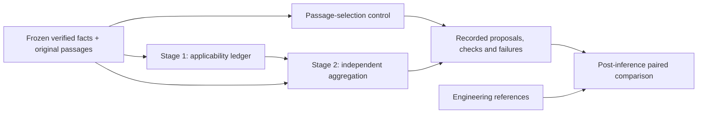

# Applicability-first judgment comparison

The completed eight-case development comparisons below are preserved. The next
locked replay and source-literal sensitivity have separate configurations and result
identities; see [Fact availability sensitivity](fact_sensitivity.md). Their planned
792 and 312 conditions must not be reported as completed merely because preparation
and preflight have succeeded. Production interfaces and rules remain unchanged.

This isolated development experiment tests whether recording passage applicability
before a separate aggregation call changes evidence-backed fitness proposals.
It does not modify production rules, uploaded case results or licensing decisions.

## Comparison contract

The contemporary control uses the existing `passage_selection` protocol. The
`applicability_first` arm first records a short structured ledger for **every**
supplied original passage: statement type, licence pathway, patient applicability,
prerequisites, numeric application, verified fact references and a proposed finding.
The second call reads the same original patient facts and passages, plus that
fallible ledger, and generates its **own** criterion checks and provisional outcome.
It can disagree with the first call; the original ledger remains unchanged.



Both arms use identical frozen inputs, judge model revision, temperature 0, seed 0,
8192-token context and 2048-token output allowance per call. The two-stage arm has
additional calls and model-generated context, so this is a protocol intervention,
not an isolated test of JSON field order. All stages and repairs contribute to cost.

The experiment imports the 94-unit reviewed corpus and exact prepared evidence
payloads from `outputs/experiments/passage_comparison_clean_v1`. It verifies the
upstream manifest, code snapshot, corpus fingerprint and retrieval artifact hashes.
No new retrieval, source supplementation or patient extraction occurs during the
comparison. The module-query arm and manually selected reference-evidence control
are reported separately. Reference evidence is diagnostic, not a deployable RAG method.

The eight cases are known development cases, not an independent validation cohort.
There are two models, two evidence policies, two protocols and three independent
calls per condition: **192 planned conditions**. Three temperature-zero repetitions
measure repeatability; they are not 192 independent patients. The principal outcome
is **Engineering reference agreement**, not clinical accuracy. Macro-F1 uses five
fixed outcome classes, with zero-division F1 set to zero and failed conditions counted
as missed reference labels. Class support and confusion matrices are retained.

## Execution and inspection

```powershell
.\.venv\Scripts\fitness-rag.exe applicability-comparison
.\.venv\Scripts\fitness-rag.exe applicability-comparison --resume
```

`--max-conditions` limits newly recorded conditions for engineering inspection. A
limited run remains partial. Model phases run serially; no framework fallback or
automatic production switch is allowed. The existing reviewed-corpus retrieval
experiment remains frozen: adding new source files changes its strict code identity,
so use this explicitly separate comparison instead of rebinding its resume manifest.

Open `outputs/experiments/applicability_comparison_bound_v2/index.html` to compare the same
case and model across evidence policies and protocols. Cards include final checks,
all first-stage records and raw model requests/responses, original source text, page,
section and frozen patient inputs. Inspect:

- `summary.json` / `summary.csv`: first-pass and final agreement, validity and cost.
- `paired_analysis.json`: accepted wrong-to-correct and correct-to-wrong transitions;
  failed-to-valid recovery is a separate category.
- `classification.json`: confusion matrices, class support and fixed-class Macro-F1.
- `results.jsonl`: immutable condition-level measurements, stage attempts and failures.
- `review.csv`: source-support and applicability review worksheet; annotations survive
  report regeneration and incompatible source changes are rejected.
- `support_review/index.html` and `support_review/review.csv`: exact-duplicate
  evidence-claim packets for independent review, with the engineering reference
  labels and overall assessment field withheld. Repeated occurrences remain linked.
- `manifest.json`, `source_snapshot.json`, `retrieval_inputs.json`, `corpus.json`:
  configuration, code, model, original text and input fingerprints.

At most one structural repair is allowed per stage. Provider errors, truncation,
budget failures and original-text materialization failures are retained without
semantic repair. Flags never change a model's outcome. Invalid identifiers, additional
control metadata and references to unverified facts are rejected. Missing or unknown
prerequisites remain inspectable; source-ID validity does not establish that a model
has interpreted a guideline correctly.

Resume is at completed-condition granularity. A stopped process may have an
unfinished condition whose provider work must be repeated; no unfinished condition
is counted as successful. Review an abandoned exclusive lock before removing it.

## Acceptance boundaries

Synthetic contract tests cover source scope, original Unicode spans, explicit false
and zero values, missing prerequisites, unverified references, invalid passage IDs,
truncation, control-label leakage and a final check disagreeing with its preceding
ledger without modifying it. These tests validate the engineering interface; they
do not establish clinical correctness, complete prerequisite extraction or numeric
entailment. Negation, boundary values, cause investigation and permission scope
remain subject to case-level empirical and independent human review.

## Completed original contract comparison

The original contract run in `applicability_comparison_v1` completed **192/192**
conditions with **305 actual model calls**, 155 accepted final outputs and 37 failed
conditions. Raw requests/responses and the complete original package source snapshot
are preserved. Its source matched the snapshot at completion; later contract work
has a separate identity. There are 574 original-location review items pending review.

| Judge | Evidence | Control agreement | Two-stage agreement | Control valid | Two-stage valid |
|---|---|---:|---:|---:|---:|
| Llama 3 8B | Module query | 0/24 | 5/24 | 23/24 | 14/24 |
| Llama 3 8B | Reference control | 6/24 | 7/24 | 24/24 | 22/24 |
| Qwen 3.5 4B | Module query | 9/24 | 0/24 | 21/24 | 6/24 |
| Qwen 3.5 4B | Reference control | 12/24 | 15/24 | 24/24 | 21/24 |

Denominators include failed conditions and three calls per case. The unchanged-input
protocol pairs contain 11 accepted wrong-to-correct transitions across three distinct
cases: SYN-EXT-003, VAL-MIX-04 and VAL-MIX-07. There are no accepted correct-to-wrong
transitions, but 29 valid-to-failed transitions include **11 formerly correct control
judgments**. Both arms therefore total 27/96 reference agreements. This is not an
overall improvement and does not justify a production switch. Outcome agreement
alone also misses unsupported explanations: some Llama improvements still misclassify
the cited acute restriction as conditional permission. Qwen's corrected diplopia
outcome still has a structured pathway field inconsistent with its text. Original
support and clinical review remain pending.

The run used about 2,849 measured condition-seconds (including provider work and
repairs). Two-stage costs include both calls, not just final aggregation. Repeated
outcomes are stable in 49 of 64 case/model/evidence/protocol groups, unstable in one,
and ineligible for stability assessment in 14 because at least one call failed.
Temperature zero does not guarantee identical outcomes.
Elapsed times are observed workstation costs: engineering tests and read-only
report preparation overlapped portions of the runs. They are not isolated latency
benchmarks. Actual request counts, token counts, failures and stage costs remain
recorded; do not infer a controlled throughput advantage from elapsed totals.

Use `review.html` for paired inspection: both arms remain adjacent under case,
model, evidence, repeat, status and error filters. First-stage flags and final-stage
flags appear separately, and raw attempt downloads retain failed and repaired calls.
`presentation_manifest.json` pins the renderer and immutable result snapshot.

The independent support-packet builder groups the original 574 claim occurrences
into 250 exact review packets: 174 final-check claims and 76 first-stage claims.
It groups only identical claims, patient facts and original locations; it does not
use fuzzy similarity or infer support. The complete occurrence list remains in
`support_review/packets.json`. Reference outcomes are withheld from these packets;
model claim text stays unchanged. This reduces repeated review work without filling
any reviewer label or replacing the original 574-item attempt audit.

## Program-bound slot revision

All 33 two-stage failures in the original run occurred before aggregation: 21 failed
full passage-ID/order coverage and 12 failed redundant prerequisite/direct-fact list
agreement. These are interface failures, not evidence that a model reached a wrong
valid final judgment. Four other failures occurred in the single-call control.

The new `applicability_comparison_bound.yaml` configuration preserves the same
patients, evidence, judges, context/output budgets and two-stage semantics. Stage one
now fills a required `passages` object with program-bound slots P1...P5. The program
derives each slot's original passage ID and module; the model cannot rename either.
Direct and prerequisite fact references are independently validated against frozen
facts, then their explicit union is derived. Unknown facts and duplicate JSON keys
are rejected. This removes redundant copying, not interpretation checks; missing
slots remain failures and semantic inconsistencies remain visible without repair.

This revision changes the first-stage schema and identifier metadata together, so
any change is a contract intervention rather than an isolated claim about field
order. It has a separate output and source snapshot. The original 192-condition run
is never overwritten or resumed using revised code.

Presentation tools run only after the writer stops:

```powershell
.\.venv\Scripts\python.exe tools/render_applicability_report.py outputs/experiments/applicability_comparison_bound_v2
.\.venv\Scripts\python.exe tools/build_support_review_packets.py outputs/experiments/applicability_comparison_bound_v2
```

`tools/compare_applicability_contracts.py` compares completed revisions only after
verifying their completed raw-result snapshots, unchanged upstream artifacts,
patient/evidence payloads and judge pins. It requires the first request of every
single-stage control pair to be identical, and separates format recovery from
accepted judgment improvement. Changes remain associated with individual cases.

## Completed program-bound revision

The separately frozen `applicability_comparison_bound_v2` run completed **192/192**
conditions and **295 actual model calls**. Final outputs are accepted in 189
conditions; three single-stage Qwen module-query controls fail source/module binding
for VAL-MIX-07. The two-stage arm completes **96/96**, including four conditions
recovered after one structural repair. Overall first-pass pipeline validity is
185/192. No reference outcome or semantic contradiction flag is used for repair.

| Judge | Evidence | Contemporary control agreement | Two-stage agreement | Control valid | Two-stage valid |
|---|---|---:|---:|---:|---:|
| Llama 3 8B | Module query | 0/24 | 3/24 | 24/24 | 24/24 |
| Llama 3 8B | Reference control | 6/24 | 10/24 | 24/24 | 24/24 |
| Qwen 3.5 4B | Module query | 9/24 | 15/24 | 21/24 | 24/24 |
| Qwen 3.5 4B | Reference control | 12/24 | 12/24 | 24/24 | 24/24 |

Within this run, the control has 27/96 engineering agreements and the two-stage arm
40/96. The paired transitions are 13 accepted wrong-to-correct, three accepted
correct-to-wrong, 24 accepted both-correct, 53 accepted both-wrong, and three
failed-to-valid. All three recovered failures now match the reference, but they
are **not** counted as accepted incorrect judgments corrected. The 13 accepted
improvements involve five distinct cases; repeats and evidence conditions are not
independent patients.

Concrete cases remain inspectable:

- Qwen's SYN-EXT-020 module-query control is incorrect in all three calls; the
  two-stage arm matches the hearing boundary reference in all three, with the
  verified 39.9 value correctly compared against the supplied original criterion.
  Its categorical finding label is still imperfect, and the reference-evidence
  control does not show the same success. Do not infer general numeric reliability.
- Llama's VAL-MIX-07 has two accepted improvements under module queries and three
  under reference evidence; other explanations still confuse conditional permission
  and acute restriction. Outcome agreement does not establish source support.
- Qwen's VAL-MIX-04 reference-evidence calls improve from temporary restriction to
  the engineering both-pathway exclusion category in all three calls. The same
  improvement cannot be generalized to every retrieved-evidence condition.
- Qwen's VAL-MIX-06 reference-evidence calls regress in all three: the control's
  `temporarily_unfit` becomes `does_not_meet_standard`. This regression must be
  reported beside the improvements.

Across contract revisions, two-stage final validity improves from 63/96 to 96/96.
Only one previously accepted incorrect condition becomes correct, five previously
accepted correct conditions regress, and 17 formerly failed conditions become
accepted and reference-consistent. Thus the revision's 27-to-40 agreement increase
is mainly improved evaluability, not 13 previous misclassifications corrected.
`contract_revision_comparison.json` verifies all 96 identical first control requests,
the same input/evidence fingerprints, corpus and model pins, and the three intended
package source changes. Despite identical control requests, three recorded control
outcomes differ between runs. This reinforces the need to retain contemporaneous
controls and repetition data.

Repeatability groups are 59 stable, four unstable, and one ineligible due to failed
calls. `support_review` groups 900 claim occurrences into 410 exact review packets
(266 final checks, 144 first-stage claims), without filling reviewer labels. The
complete project suite passed **437 tests** and Ruff lint checks passed. Production
rules and clinical review remain unchanged. This is a completed development
comparison, not the completed six-method, 33-case revised-corpus evaluation or a
clinical acceptance claim.
