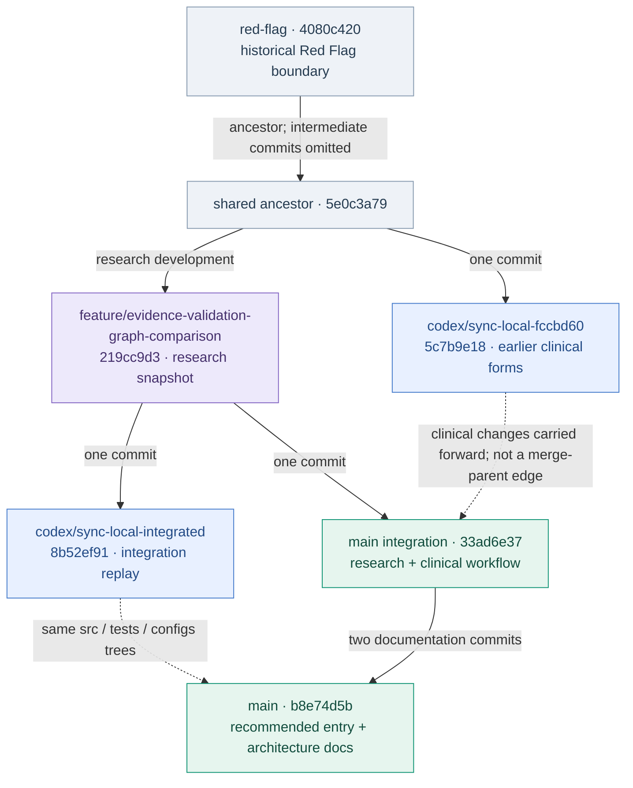

# Branch relationships and implementation guide

Audit date: **2026-11-05 (Asia/Shanghai)**. This is a pinned code/history snapshot taken **before the README synchronization commits in this change**. Branch names move; the linked SHAs and tree identities below define the evidence. Added documentation commits will change live ahead/behind counts without changing these audited application trees.

## Which branch should I use?

Use [main](https://github.com/Zicheng-Xie/Occupational-Fitness-Platform/tree/main) for the integrated application and current documentation. These five branches are development histories of one platform, rather than five separately deployed products. The two core runtime modules (case intake/Red Flag and evidence/reporting) coexist on main.

| Branch | Audited head | History relative to audited main (+ ahead / − behind) | Role / recommendation |
|---|---|---|---|
| [codex/sync-local-fccbd60](https://github.com/Zicheng-Xie/Occupational-Fitness-Platform/tree/codex/sync-local-fccbd60) | [`5c7b9e18`](https://github.com/Zicheng-Xie/Occupational-Fitness-Platform/commit/5c7b9e18982b1f08125fe9cbb916393d32ce82f4) | diverged; +1 / −7 | Earlier clinical-form integration on an older base; lacks 44 source files present in main. |
| [codex/sync-local-integrated](https://github.com/Zicheng-Xie/Occupational-Fitness-Platform/tree/codex/sync-local-integrated) | [`8b52ef91`](https://github.com/Zicheng-Xie/Occupational-Fitness-Platform/commit/8b52ef910e3fe05982178969c565359f077b55b7) | diverged; +1 / −3 | Integration replay on the research base; audited application source, tests, configs and every other root entry except README/docs match main exactly. |
| [feature/evidence-validation-graph-comparison](https://github.com/Zicheng-Xie/Occupational-Fitness-Platform/tree/feature/evidence-validation-graph-comparison) | [`219cc9d3`](https://github.com/Zicheng-Xie/Occupational-Fitness-Platform/commit/219cc9d3797d888cde9a6716d37b129b2556adeb) | behind; +0 / −3 | Research snapshot: ten-route retrieval, paired judgment audits and prospective-review preparation; its audited head is an ancestor of main. |
| [main](https://github.com/Zicheng-Xie/Occupational-Fitness-Platform/tree/main) | [`b8e74d5b`](https://github.com/Zicheng-Xie/Occupational-Fitness-Platform/commit/b8e74d5b0ce79834029f49ccf0830ad69300ecfe) | Baseline | Recommended entry point: integrated clinical workflow, PDF forms and retrieval/judgment research. |
| [red-flag](https://github.com/Zicheng-Xie/Occupational-Fitness-Platform/tree/red-flag) | [`4080c420`](https://github.com/Zicheng-Xie/Occupational-Fitness-Platform/commit/4080c420142e8472537895067976d57ca6539266) | behind; +0 / −20 | Historical v0.4.0 Red Flag boundary; its audited head is an ancestor of main. |

Ahead/behind counts describe commit ancestry, not missing features. In particular, the integrated replay has one unique commit but no application-tree difference from main. A branch containing an ancestor commit does not guarantee its old behavior is unchanged: subsequent main commits revise it.

## Relationship diagram



Solid arrows mean proven commit ancestry (some intermediate commits are collapsed). Dotted arrows describe code-content relationships, **not Git merges**. Both integration commits `33ad6e37` and `8b52ef91` have the same single parent `219cc9d3`; they are sibling commits, not a merge of one another. The earlier clinical commit `5c7b9e18` is not an ancestor of main.

## Code-backed capability matrix

Source counts include all Git-tracked blobs under `src/`, not lines of code or passing tests. Presence and exact tree equality were checked; this audit did not run historical branch test suites.

| Capability / owning files | main | integrated replay | earlier clinical branch | research snapshot | red-flag snapshot |
|---|---|---|---|---|---|
| Source files under `src/` | 131 | 131 (identical tree) | 87 | 129 | 59 |
| Default model in `configs/workflow.yaml` | Qwen3 14B | Qwen3 14B | Qwen3 14B | Llama3 8B | Llama3 8B |
| Grounded intake + deterministic rules (`case_intake/`, `red_flag.py`) | Present | Identical | Present; six shared source files differ from main | Present; later clinical revisions absent | Earlier implementation |
| Independent semantic-review implementation (`case_intake/semantic_review.py`) | Present | Identical | Present; differs from main | Present; differs from main | Absent |
| Clinical PDF form writers (`web/clinical_record.py`, `web/fitness_form.py`) | Both present | Identical | Both present | Both absent | Both absent |
| Case-allocation and prospective-review research (`evaluation/case_evidence_allocation.py`, `evaluation/prospective_review.py`) | Present | Identical | Absent | Present | Absent |
| Current README architecture and progress navigation | Present | Branch-specific notice + main navigation | Branch-specific notice + main navigation | Branch-specific notice + main navigation | Branch-specific notice + main navigation |

Default models were read from each pinned branch configuration. Main's workflow selects exact binding for fast cases and exact binding or semantic RAG for other cases; the older research branch does not acquire this behavior just by linking here.

### Why the two sync branches exist

- `sync-local-fccbd60` applies clinical integration to `5e0c3a79`, before the later research commits. All 87 of its source paths exist on main; main has 44 additional source paths and six changed shared blobs. This supports comparing the earlier integration, not selecting it as the fullest application.
- `sync-local-integrated` applies integration to `219cc9d3`, the later research snapshot. At the audit, **all root entries except README and docs match main by Git object SHA**. It is a content-equivalent replay, despite having a different commit identity.
- `feature/evidence-validation-graph-comparison` contributes the research baseline already in main. Its 129 source paths are all present on main; main adds the two form writers and changes 13 shared source blobs.
- `red-flag` is an older v0.4.0 snapshot already in main's ancestry. Its README describes that snapshot, so advertising current Qwen/form/research features there would be inaccurate.

### Where to inspect the implemented features

Paths below are on main; use each branch's pinned tree when checking historical behavior.

| User capability | Main implementation | What the code establishes |
|---|---|---|
| Clinical record PDF → model-visible note | [clinical_record.py](https://github.com/Zicheng-Xie/Occupational-Fitness-Platform/blob/main/src/occupational_fitness_rag/web/clinical_record.py) | Clinical-record extraction adapter; inspect routes/jobs for orchestration. |
| Editable fitness report PDF | [fitness_form.py](https://github.com/Zicheng-Xie/Occupational-Fitness-Platform/blob/main/src/occupational_fitness_rag/web/fitness_form.py) | PyMuPDF widget mapping, practitioner/system opinion options and saved-form manifest entries. A filled form is not an electronic sign-off. |
| Grounded extraction and semantic review | [case_intake/](https://github.com/Zicheng-Xie/Occupational-Fitness-Platform/tree/main/src/occupational_fitness_rag/case_intake) | Source validation and independent review before deterministic rules. |
| Exact evidence / semantic RAG | [pipeline/workflow.py](https://github.com/Zicheng-Xie/Occupational-Fitness-Platform/blob/main/src/occupational_fitness_rag/pipeline/workflow.py), [retrieval/](https://github.com/Zicheng-Xie/Occupational-Fitness-Platform/tree/main/src/occupational_fitness_rag/retrieval) | Rule-bound routing, mode selection and evidence retrieval. |
| Frozen retrieval and judgment studies | [evaluation/](https://github.com/Zicheng-Xie/Occupational-Fitness-Platform/tree/main/src/occupational_fitness_rag/evaluation), [findings](https://github.com/Zicheng-Xie/Occupational-Fitness-Platform/blob/main/docs/case_allocation_judgment_findings.md) | Experimental evidence and engineering-reference agreement; prospective clinical validation remains pending. |

## README synchronization policy

This change synchronizes **branch identity, navigation and implementation boundaries** across all five READMEs. Historical setup commands, models, measurements and release descriptions stay attached to their actual branch. Main carries the full current architecture, progress tables and this relationship guide. The replay branches link to main instead of claiming historical ancestry equals a pending feature merge.

No branch is deleted, merged, rebased or renamed by this documentation update. Future functional changes should start from updated main; compare pinned commits before porting anything from an older branch. Keep research artifacts immutable and preserve their original corpus/model/protocol identities.

## Reproduce the audit

Inspect the immutable [main baseline](https://github.com/Zicheng-Xie/Occupational-Fitness-Platform/tree/b8e74d5b0ce79834029f49ccf0830ad69300ecfe) and the branch-head links in the table. For each other pinned SHA:

```sh
git fetch origin
git merge-base <main-sha> <branch-sha>
git rev-list --left-right --count <main-sha>...<branch-sha>
git diff --stat <main-sha> <branch-sha> -- src tests configs
git rev-parse <main-sha>:src <branch-sha>:src
```

GitHub's [three-dot comparison](https://github.com/Zicheng-Xie/Occupational-Fitness-Platform/compare/b8e74d5b0ce79834029f49ccf0830ad69300ecfe...8b52ef910e3fe05982178969c565359f077b55b7) shows changes since the common ancestor; it is not a direct tip-to-tip content comparison. Use tree identities or `git diff <main-sha> <branch-sha>` for current content.

### Immutable directory identities

| Pinned branch | src tree | tests tree | configs tree |
|---|---|---|---|
| codex/sync-local-fccbd60 | `7e5ec502ccae2e49819fbb93de233499a37b8cf6` | `afb3a2f778b080fd32d5671de0bb4088a8869026` | `de9a001d890f6f1b8a621308fd59055bda812e64` |
| codex/sync-local-integrated | `130af02375097b0e9394cb924c7958cf01837340` | `088d7deb3ff6e1a381fbf8c3d80bf50e8fd46194` | `089af704d42453320de0b44d99129c500337b235` |
| feature/evidence-validation-graph-comparison | `3d639cf0981068beb1ca065fed3f0bae99b4c80d` | `10d8824dc1d51a2de357361e5769f5c2f57faf3e` | `de8bc0865cf253da8d01132e69900a61142729d2` |
| main | `130af02375097b0e9394cb924c7958cf01837340` | `088d7deb3ff6e1a381fbf8c3d80bf50e8fd46194` | `089af704d42453320de0b44d99129c500337b235` |
| red-flag | `bec3bde317635cc9456cfc7c71d8eab4dc810727` | `ebca16396a7d6450e15f743f423a8ea77e068867` | `41f1d69b89f7080b2cc7436bbc1dccf67f592317` |

Machine-readable snapshot: [branch_audit_2026-11-05.json](branch_audit_2026-11-05.json). Counts and identities refer to pre-sync SHAs, so subsequent documentation commits do not invalidate the snapshot.
